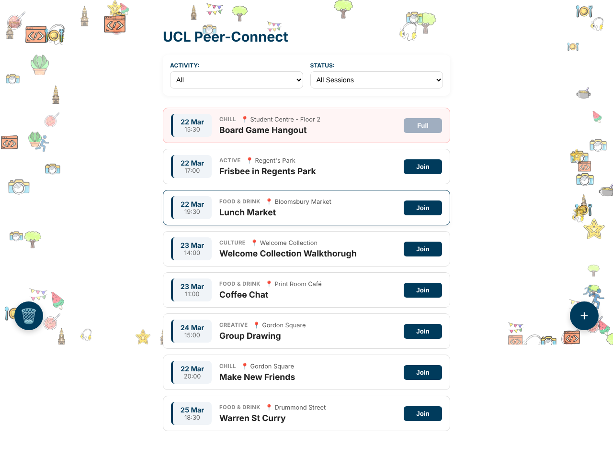

# UCL Peer-Connect

A web app for UCL students to find and arrange informal meetups: board games, sports, food, culture and creative sessions. Built by a group of 4 as part of UCL Design and Professional Skills.


## Features

- **UCL login:** sign in with a name and a `@ucl.ac.uk` email address
- **Browse sessions:** filter by activity type, by the sessions you've joined, or by sessions with space available
- **Join and leave:** the participant list updates as you join or leave, and full sessions can't be joined
- **Create and edit sessions:** add your own session (up to a week ahead) and edit sessions you've created
- **Subject bin:** shows the subjects binned in the last 24 hours

## Tech stack

React 19 (Create React App), CSS Modules, Framer Motion and Lucide icons.

The app is frontend-only. Session data comes from mock data in `src/utils/mockData.js` and is held in React state, so nothing persists after a refresh. A MongoDB and Express backend was planned but not built within the project timeframe.

## Running it

Requires Node.js 18 or later.

```bash
cd frontend
npm install
npm start
```

Then open http://localhost:3000.

## Credits

Background icons from [Flaticon](https://www.flaticon.com/).
